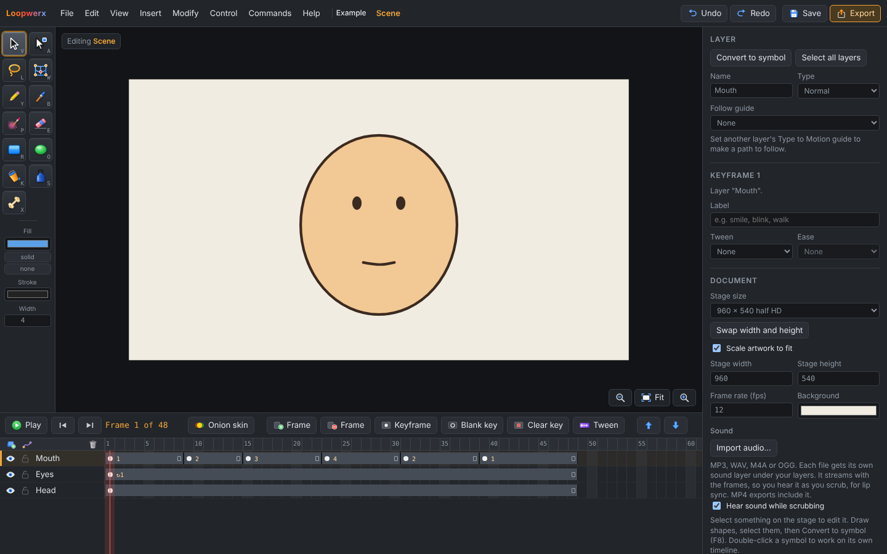

# Loopwerx

A 2D animation app for the browser, built around symbols with their own timelines, in the spirit of classic Flash. Draw on a timeline, turn drawings into symbols, give each symbol frames of its own, and pick which of its frames shows from the timeline outside it. It also has a lattice, bones that bend artwork, sound for lip sync, and GIF, MP4, PNG and SVG export.

Loopwerx is one HTML file. It has no build step and no server, and your work is saved in your browser.

The version number is in the top bar. Click it to see what changed, or read [CHANGELOG.md](CHANGELOG.md).



## Getting started

Open `index.html` in Chrome or Edge, or serve the folder and open it:

```sh
python3 -m http.server 8000
# then open http://localhost:8000
```

To host it, enable GitHub Pages for the repository and point it at the root folder. `index.html` is the whole app.

Loopwerx opens with a small example: a face whose mouth is a symbol, with the mouth shape picked per keyframe. Right-click anything for more options. Help > Keyboard shortcuts lists the keys.

## Features

### Symbols and timelines
- Convert any drawing to a symbol (F8). Every symbol has its own timeline with layers and keyframes.
- Double-click a symbol to edit it in place. The breadcrumb at the top takes you back out.
- **Frame Picker (F):** a floating window that shows every frame inside the selected symbol as a thumbnail, with a large preview and a slider. Click a frame and the symbol shows it on the current timeline frame, with a keyframe made for you. Filter by labels or by the symbol's own keyframes, and step between keyframes on the layer. This is how lip sync and blinks work.
- For each keyframe, choose whether the symbol loops, plays once or holds a single frame.
- **Layer palette:** show and hide a symbol's own layers, or pin one of them to a frame, without opening the symbol.
- Frame labels, onion skin, motion guides, and classic and shape tweens with easing.
- Drag keyframes to move them. Alt-drag copies, and Shift-click selects more than one.
- Zoom the timeline with 1 and 2 after clicking in it, or with Ctrl and the mouse wheel.

### Drawing
- **Pencil (Y):** an even line in the stroke colour, with ink, smooth and straighten modes.
- **Brush (B):** solid vector strokes in the fill colour that thicken with pen pressure.
- **Textured brush (P):** soft, airbrushed and textured paint kept as vector dabs. It includes the Milo Soft Brushes, and Toon Boom brush files (`.tbr`) can be imported.
- Rectangle and oval tools, an eraser, a gap-closing paint bucket, an ink bottle, lasso and subselection.
- Brush modes: normal, paint behind, paint fills, paint selection and paint inside.
- **Fill and stroke selection, as in Flash:** one click selects just the fill or just the outline, and a double-click selects both. Delete removes only the part you selected, and dragging a part pulls it away from the rest. You can turn this off in the Edit menu.
- Solid colours and linear or radial gradients.

### Deforming
- **Lattice (W):** a 4 by 4 mesh lattice for bending a symbol, including its middle. Clicking a plain drawing wraps it in a symbol for you.
- **Bones that bend artwork (X):** drag across a drawing to add a bone, then drag from its tip to add the next. Drag a bone to bend the drawing using inverse kinematics.
  - Joints keep their thickness: the outside rounds off and the inside creases.
  - Poses sit on their own track, so you draw once and pose on any frame. Poses ease into each other.
  - **Joint softness** sets how tight each bend is, and **Paint weights** lets you paint which parts follow which bone, shown as a heat map.
- **Symbol bones:** drag from one symbol to another to join them into a chain.

### Pictures and sound
- Import PNG, JPG, GIF, WebP and SVG pictures by menu, drag and drop, or paste.
- Import Photoshop files (`.psd`) as a symbol with matching layers, as layers on the current timeline, or as one flattened picture.
- Import audio onto sound layers. Sound streams with the frames, so you hear it as you scrub.
  - Sound clips can be dragged like keyframes, and set to Stream or Event sync.
  - **Split audio** opens a waveform window for cutting a clip into pieces, with automatic splits at pauses.

### Files and export
- Auto save, named projects, snapshots, and download and open of project files (`.json`, with pictures and sound inside).
- Export the whole scene to animated GIF or MP4 (with sound), or the current frame to PNG or SVG.
- Stage size presets, including 1920 × 1080 and 1080 × 1920.
- **Flash and Animate extensions:** install `.zxp`, `.mxp` and `.jsfl` files from the Commands menu.
  - HTML panels (CEP) open in their own floating window. Loopwerx stands in for Adobe's CSInterface, so `evalScript` calls, `fl.runScript` into the extension's own JSFL files, and selection, timeline and document events all work.
  - JSFL commands run in a worker against a subset of the Flash JavaScript API.
  - Panels that depend on Animate features Loopwerx doesn't have, native file access or SWF won't fully work.

## Keyboard shortcuts

| Key | Action | Key | Action |
| --- | --- | --- | --- |
| V | Selection | F5 / Shift+F5 | Insert / remove frame |
| A | Subselection | F6 / Shift+F6 | Insert / clear keyframe |
| L | Lasso | F7 | Insert blank keyframe |
| W | Lattice | F8 | Convert to symbol |
| Y | Pencil | T | Toggle tween |
| B | Brush | Enter | Play / stop |
| P | Textured brush | , and . | Previous / next frame |
| E | Eraser | Home / End | First / last frame |
| R | Rectangle | 1 / 2 | Zoom the stage out / in |
| O | Oval | [ and ] | Brush size |
| K | Paint bucket | M | Brush mode |
| S | Ink bottle | Delete | Delete selection |
| X | Bone | Esc | Leave symbol or weight painting |
| F | Frame Picker window | 1 / 2 in the timeline | Zoom the timeline out / in |
| Ctrl+Z / Ctrl+Shift+Z | Undo / redo | Ctrl+C / X / V | Copy / cut / paste |
| Ctrl+D | Duplicate | Ctrl+Shift+V | Paste in place |
| Ctrl+A | Select all | Ctrl+Shift+I | Import image |
| Ctrl+S | Save | Ctrl+O | Open |

On a Mac, use Cmd instead of Ctrl.

## Browser support

Loopwerx is developed and tested in Chrome.
- MP4 export uses WebCodecs, which Chrome and Edge support. Where WebCodecs is missing, video export falls back to WebM.
- Everything else uses standard web APIs (SVG, Canvas, Web Audio and IndexedDB) and should work in current browsers. It hasn't been tested much outside Chrome.

## Where your work is kept

Projects, snapshots, pictures and sound are saved in the browser's local storage and IndexedDB, on your own machine. Nothing is uploaded anywhere. Clearing site data for the page deletes them, so use File > Download to keep a copy of anything important.

## How it's built

All the code is in `index.html`: HTML, CSS and one JavaScript module with no framework.
- The stage is SVG, and a Canvas 2D renderer handles export, the paint bucket and the textured brushes.
- A few libraries are loaded from a CDN only when a feature needs them. See [THIRD_PARTY_NOTICES.md](THIRD_PARTY_NOTICES.md).
- Opening the page needs no network except for the web fonts.

## Trademarks

Adobe Flash, Adobe Animate and Photoshop are trademarks of Adobe. Toon Boom is a trademark of Toon Boom Animation. Loopwerx isn't affiliated with or endorsed by either company. These names appear only to describe compatible file formats and familiar workflows.

## Licence

No licence has been chosen yet. Until one is added, all rights are reserved by the author.
